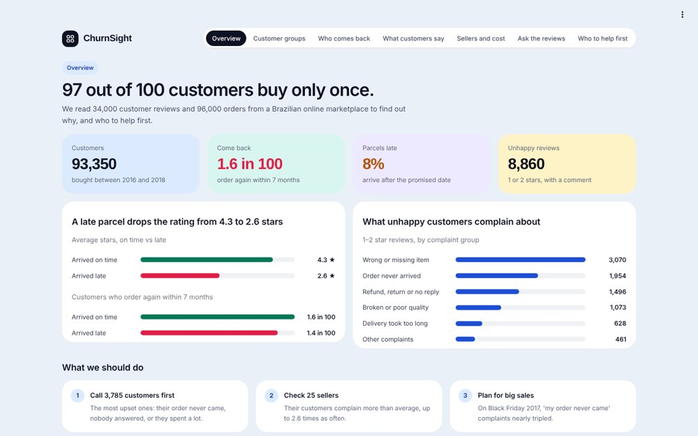
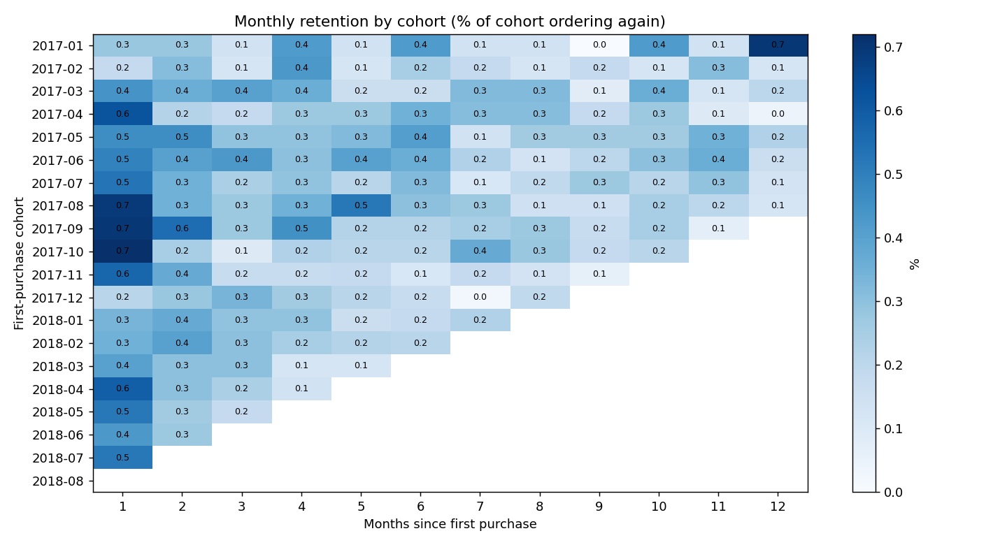

# ChurnSight

**Customer 360 intelligence: link what customers *say* (reviews) with what they *do* (orders) to explain churn and decide what to do next.**

**Live demo:** https://churnsight-s5dv.onrender.com (free hosting: the first visit after a quiet spell takes ~1 minute to wake up. The demo runs the light version, where "Ask the reviews" searches with Portuguese keywords.)



The dashboard is written for non-technical readers: every page opens with one plain-language headline, and the model metrics sit behind "Technical details". Theme: animated aurora background with glass cards (pure CSS).

Built on the public [Olist Brazilian E-commerce dataset](https://www.kaggle.com/datasets/olistbr/brazilian-ecommerce) (~100k orders, 2016–2018, reviews in Portuguese).

## Results at a glance

| Area | Result |
|---|---|
| Data | 96,470 delivered orders · 93,350 customers · 34,340 clean text reviews (Portuguese) |
| Retention reality | **97% of customers buy once**; only **1.55%** return between day 30 and day 210 |
| Review topic classifier (held-out gold set, 250 reviews) | Topic macro-F1 **0.835** (fine-tuned BERTimbau, two-stage) vs **0.636** keyword rules and **0.666** TF-IDF |
| Retrieval (16 EN + PT queries, exact relevance) | Hybrid nDCG@10 **0.79**; BM25 alone fails on English questions (**0.09**) |
| Complaint discovery | **28 recurring complaint clusters** from 8,860 1-2★ reviews (2% unassigned) |
| Rising-issue alerts (backtest) | Flags **Nov 2017** ("order not received" +194%, z = 14.5) and **Feb-Mar 2018**, the exact months the late-delivery rate jumped from 5% to 14-21% in order data the NLP never saw |
| Retention model | ROC-AUC **0.564**, **1.6× lift** in the top 10%; contacting the top 20% finds 24% of returners (time-based split) |
| Survival | A 1-2★ first review means a **14% lower return hazard** (Cox HR 0.86, p = 0.016) |

### Review classifier: what moved the needle

| Model (all trained without gold labels) | Topic macro-F1 | Macro-F1 incl. negativity |
|---|---|---|
| Keyword rules (the weak labeller) | 0.636 | 0.565 |
| TF-IDF + LogReg, weak labels | 0.654 | 0.660 |
| TF-IDF + LogReg, weak + silver | 0.666 | 0.671 |
| BERTimbau stage 1 (weak labels) | 0.654 | 0.668 |
| **BERTimbau stage 1 → stage 2 on 480 silver reviews** | **0.846** | **0.839** |
| + per-label thresholds tuned on 120 held-out silver reviews (final) | 0.835 | 0.830 |

Training on 30k keyword labels alone teaches a model to imitate the keywords (0.654 ≈ rules). A short second fine-tuning stage on 480 carefully labelled reviews lifts topic F1 by ~19 points. The thresholds were chosen on held-out silver data before looking at gold; they happened to cost 1 point on gold, and we report that rather than switching.

*Caveat:* silver and gold labels were written by the same annotator (an LLM following the same written guideline), so part of the stage-2 gain may be learning that annotator's conventions. An independent human check of the gold set is the next step.

### What did **not** work (and what that tells the business)

- **Review text does not improve the repurchase model.** Order-only features: AUC 0.564; adding the review score: 0.564; adding topic and sentiment probabilities: 0.546. With ~600 returning customers in training and 97% one-time buyers, *who comes back* is driven mostly by product category and season (top SHAP features), not by what the first review said.
- **No single complaint topic has a significant repurchase effect.** Defects (relative risk 0.68) and wrong/missing items (0.78) show the biggest drops, but every 95% CI includes zero. The revenue at stake per topic is small (~R$2.5k) because the base return rate is tiny.
- **So the value of review intelligence here is operational, not predictive:** catching delivery crises early (the backtest alerts), finding seller hotspots (sellers with up to 2.6× the platform complaint rate), and prioritising the ~3,800 high-priority unhappy customers for outreach.
- **Cross-encoder reranking did not help** (nDCG 0.781 vs 0.792 without it), so it is off by default.



## Why this project

E-commerce teams have two disconnected views of customers:

| | What customers **say** | What customers **do** |
|---|---|---|
| Data | Reviews, complaints (unstructured text) | Orders, payments, deliveries (tables) |
| Usual project | Sentiment analysis | RFM segmentation / churn model |
| Question answered | "What are people unhappy about?" | "Who is likely to leave?" |

ChurnSight joins them per customer, so it can answer the question a business actually cares about: **which problems cost us returning customers, how much, and what should we do about each unhappy customer?**

## What it does

| Module | What | Techniques |
|---|---|---|
| 1. Review intelligence | Tag every review with 8 topics + negativity; discover recurring complaint clusters | Weak supervision (Portuguese keyword rules), fine-tuned **BERTimbau** (multi-label), multilingual sentence embeddings, **BERTopic** |
| 2. Segmentation | 5 actionable customer segments | RFM + experience features, KMeans, silhouette vs usefulness trade-off |
| 3. Retention model | Who comes back after the first order, and why | Point-in-time features, LightGBM, **SHAP**, Kaplan-Meier + **Cox** survival |
| 4. Issue impact | Repurchase gap and revenue at stake per complaint topic; seller hotspots; rising-issue alerts | Bootstrap CIs, z-score spike detection |
| 5. Ask ChurnSight (RAG) | Ask questions in English about Portuguese reviews, answered with verified citations | Hybrid retrieval (BM25 + dense, RRF), optional cross-encoder rerank, metadata filters, **LLM** answer with citation checks |
| 6. Action Center | Prioritised queue of unhappy customers with a policy-grounded reply draft | Rule engine for priority/vouchers, policy RAG, LLM structured output, guardrails |

Delivered as a **Streamlit dashboard** and a **FastAPI** service.

## Architecture

```
Olist CSVs (9 tables)
   │  data/build.py: join, clean, point-in-time features (day 30), label = return in days 30-210
   ▼
orders / customers / reviews (parquet)
   ├── analytics/cohorts.py ── cohort retention, EDA
   ├── analytics/segments.py ─ RFM + experience → KMeans → named segments
   ├── nlp/weak_labels.py ──── Portuguese keyword rules → noisy topic labels
   │      └── nlp/train_classifier.py ─ BERTimbau fine-tune → topic + negativity probabilities
   ├── nlp/clusters.py ─────── multilingual embeddings → BERTopic on 1-2★ reviews
   │      └── llm/insights.py ─ LLM names clusters, quotes verified against reviews
   ├── analytics/churn.py ──── LightGBM (A: orders · B: +score · C: +review NLP), SHAP, Cox
   ├── analytics/impact.py ─── topic → repurchase gap → revenue at stake; trends + alerts
   ├── rag/ ────────────────── hybrid retriever, retrieval eval, Ask ChurnSight
   └── llm/actions.py ──────── priority + voucher rules → policy RAG → LLM reply → guardrails
                                   │
                     app/dashboard.py (Streamlit) · app/api.py (FastAPI)
```

## Key design decisions

- **Point-in-time features (no leakage).** Every customer is scored 30 days after their first purchase, using only what was known by then (delivery status, a review written by day 30). The label is "returned between day 30 and day 210". An earlier version masked reviews written *after* a second purchase; that masking only ever hit returning customers, so "review missing" leaked the label. The fixed cut-off applies to everyone equally.
- **Same-day orders are not retention.** About 30% of raw "second orders" were placed the same day as the first (basket splits). A return needs to be at least 1 day later.
- **Weak supervision instead of hand-labelling 30k reviews.** Portuguese keyword rules label the training set; a fine-tuned transformer learns to generalise beyond the keywords. Everything is evaluated on a separate gold set of 250 reviews (50 per star rating), annotated with an LLM against a written guideline and never used for training.
- **Usefulness over a single metric.** Silhouette prefers k=3 segments, but that puts ~80% of customers in one group. We pick the best k ≥ 5 and say so.
- **Rules decide money, the LLM writes words.** In the Action Center the voucher amount comes from a rule engine that mirrors the goodwill policy. The LLM only drafts the reply. Guardrails reject drafts that change the amount, cite policies that were not retrieved, mention unapproved R$ amounts, or skip escalation on legal/safety language.
- **Exact search over an ANN index.** ~34k × 384-dim vectors: brute-force cosine takes milliseconds, so a vector database would add moving parts without benefit at this scale.
- **Works without an API key.** With `LLM_PROVIDER=none` every LLM feature falls back to retrieval-only or rule-based output, so the dashboard, API and tests run anywhere. The live demo runs this way.

## Run it

```bash
# 1. Environment (Python 3.11+). GPU optional but recommended for the classifier.
python -m venv .venv && .venv\Scripts\activate          # Windows
pip install torch --index-url https://download.pytorch.org/whl/cu126   # or the CPU wheel
pip install -r requirements-dev.txt && pip install -e .

# 2. Full pipeline (downloads the public dataset on first run)
python -m churnsight.pipeline

# 3. Optional: LLM-powered features
copy .env.example .env      # set LLM_PROVIDER=anthropic, LLM_MODEL and ANTHROPIC_API_KEY
python -m churnsight.llm.insights          # name complaint clusters
python -m churnsight.llm.queue --draft 10  # pre-draft demo replies

# 4. Apps
streamlit run app/dashboard.py
uvicorn app.api:app --reload               # http://localhost:8000/docs

# 5. Tests
pytest -q

# 6. Refresh the slim bundle the deployed app reads, then smoke-test deploy (lite) mode
python scripts/export_app_data.py
python tests/smoke_dashboard_lite.py
```

The deployed dashboard runs in **lite mode** (`CHURNSIGHT_LITE=1`): it reads the slim bundle in `data/app/` and uses BM25 search instead of the neural encoder, so it fits a 512 MB container. See `Dockerfile` and `render.yaml`.

## Project layout

```
src/churnsight/
  data/build.py            raw tables → clean, point-in-time customer table
  analytics/               cohorts, segments, churn model + survival, issue impact + alerts
  nlp/                     weak labels, BERTimbau classifier, embeddings + BERTopic
  rag/                     hybrid retriever, policy KB, Ask ChurnSight, retrieval eval
  llm/                     LLM client, cluster insights, Action Center, outreach queue
app/                       Streamlit dashboard, FastAPI
docs/policies/             synthetic policy knowledge base for a fictional marketplace
data/labels/               gold (evaluation) and silver (training) annotations
artifacts/                 metrics, tables and figures produced by the pipeline
tests/                     unit tests for rules, guardrails, spike detection
```

## Data and licence

- Olist Brazilian E-commerce Public Dataset by Olist, [CC BY-NC-SA 4.0](https://creativecommons.org/licenses/by-nc-sa/4.0/). The slim bundle in `data/app/` is derived from it and shared under the same licence, for non-commercial use.
- `docs/policies/` describes **Aurora Marketplace, a fictional company** invented for this demo. It is not Olist's policy.
- Gold labels in `data/labels/gold_annotations.txt` were produced with an LLM reading each review against a written guideline, single pass; treat them as a careful but unaudited reference.
